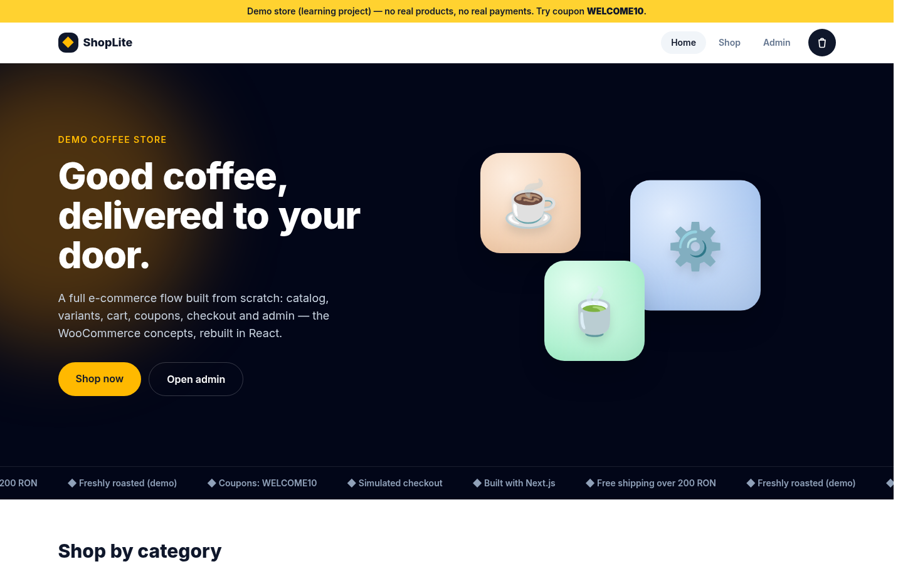
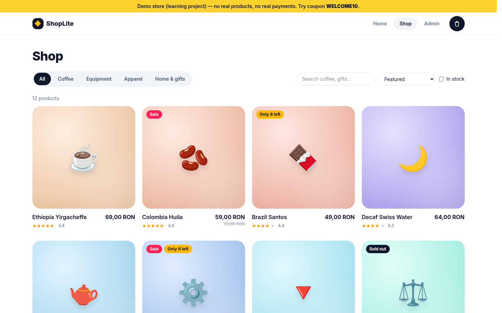
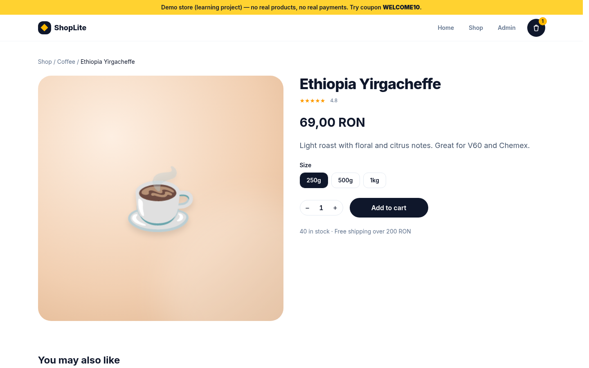
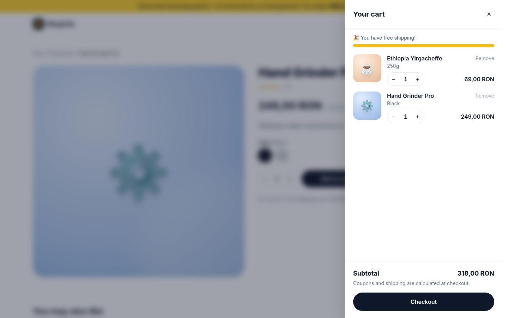
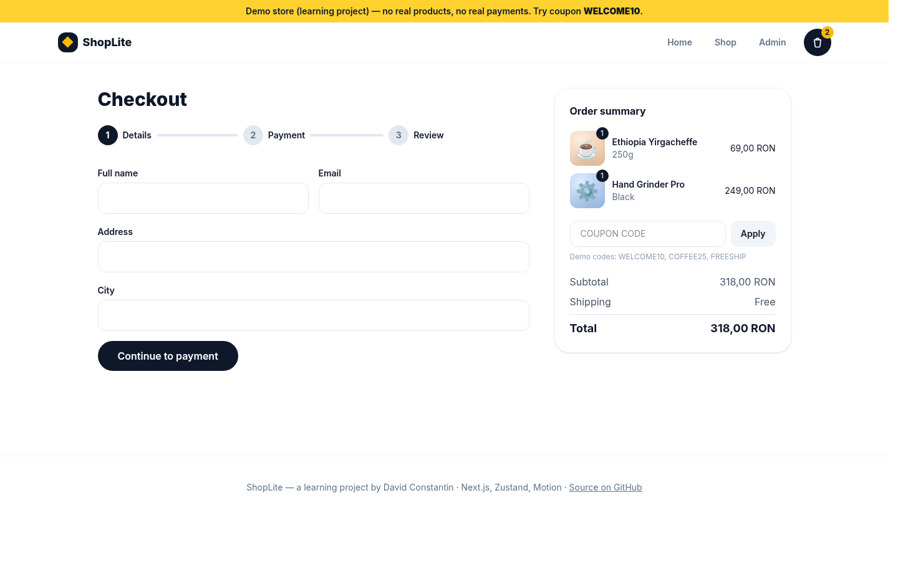
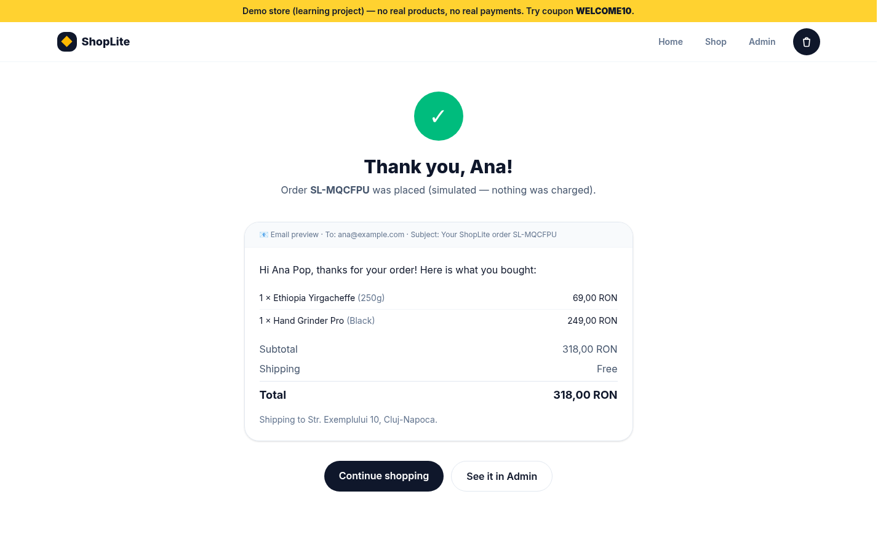
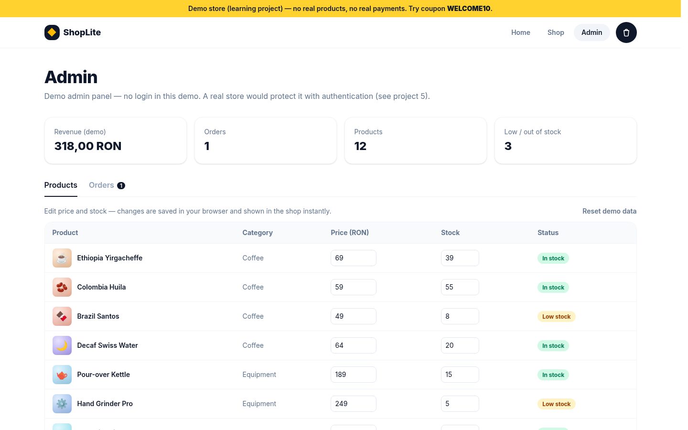

# ShopLite — headless e-commerce demo

A complete online store flow built from scratch with **Next.js 15**, **TypeScript**, **Zustand** and **Motion**, plus an **Express + Zod** API in [`/server`](server/README.md) with Stripe test-mode checkout, signed webhooks and an optional WooCommerce importer.
Learning project #6 from my portfolio plan. It is a **demo store**: no real products and no real payments.

**Live demo:** https://davidgeorgeconstantin-spec.github.io/shoplite/ · try coupon `WELCOME10`



## Features
**Store (static demo on GitHub Pages)**
- Catalog with category tabs, debounced search, sorting and "in stock" filter
- One static page per product (`generateStaticParams`) with SEO metadata and JSON-LD `Product` data
- Variants: sizes change the price (250g / 500g / 1kg), colors as swatches
- Persistent cart (Zustand `persist`), quantity steppers, free-shipping progress bar
- Coupons: percent, fixed with minimum subtotal, free shipping — validated with shared pure functions
- 3-step checkout with validation and a **simulated** payment, order confirmation with an email preview
- Admin: KPIs, inline price/stock editing (reflected in the shop instantly), orders with a status workflow; stock is decremented on checkout

**API (`/server`, run locally or on Render free tier)**
- `GET /api/products`, `POST /api/coupons/validate`, `POST /api/orders` — prices recomputed on the server, stock & variant checks
- `POST /api/checkout/stripe` — Stripe Checkout Session in **test mode** (REST API, no SDK)
- `POST /api/webhooks/stripe` — HMAC signature verification, marks orders as paid
- `GET /api/import/woocommerce` — maps WooCommerce REST products to the ShopLite model
- 8 Vitest + Supertest tests

**Animations:** fly-to-cart with curved keyframes and a cart-badge bump, staggered word reveal in the hero, scroll parallax, infinite marquee, `layoutId` pills (nav, categories, sizes, admin tabs), `AnimatePresence popLayout` grid filtering, spring cart drawer, direction-aware checkout steps, rolling numbers, input shake on invalid coupon, confetti, count-up KPIs. All disabled with `prefers-reduced-motion`.

## Stack
Next.js 15 (static export) · React 19 · TypeScript strict · Tailwind CSS 4 · Zustand 5 · Motion 12 · Express 5 · Zod · Vitest · GitHub Actions

## Structure
```
src/
├─ app/                     # routes: /, /shop, /products/[slug], /checkout, /order, /admin
├─ components/
│  ├─ layout/               # Header, Footer, DemoBanner, PageTransition, Providers
│  └─ ui/                   # QuantityStepper, Stars, AnimatedNumber
├─ data/                    # demo products & coupons
├─ features/
│  ├─ admin/                # AdminDashboard, ProductsTable, OrdersList
│  ├─ cart/                 # cartStore, useCartSummary, CartDrawer, CartButton, fly-to-cart
│  ├─ catalog/              # Catalog, ProductCard, ProductArt, filters, inventoryStore
│  ├─ checkout/             # Checkout, CouponField, OrderSummary, orderStore, OrderConfirmation
│  ├─ home/                 # Hero, HomeSections
│  └─ product/              # ProductDetail, VariantPicker
├─ hooks/                   # useProducts, useHydrated, useDebounced
├─ lib/                     # pricing (pure), money, id, cn
└─ types/
server/
├─ src/lib/                 # orders, store, stripe, woocommerce
├─ src/routes/api.ts
├─ src/shared/              # same pricing rules as the frontend
└─ test/
```

## Run locally
```bash
npm install && npm run dev          # http://localhost:3000/shoplite
cd server && npm install && npm run dev   # http://localhost:4000 (see server/README.md)
```

## Deploy
`.github/workflows/deploy.yml` builds the static export and publishes it to GitHub Pages (Settings → Pages → Source: **GitHub Actions**). `server-tests.yml` runs the API tests.

## Screenshots
| Shop | Product | Cart |
|---|---|---|
|  |  |  |
| **Checkout** | **Order** | **Admin** |
|  |  |  |
